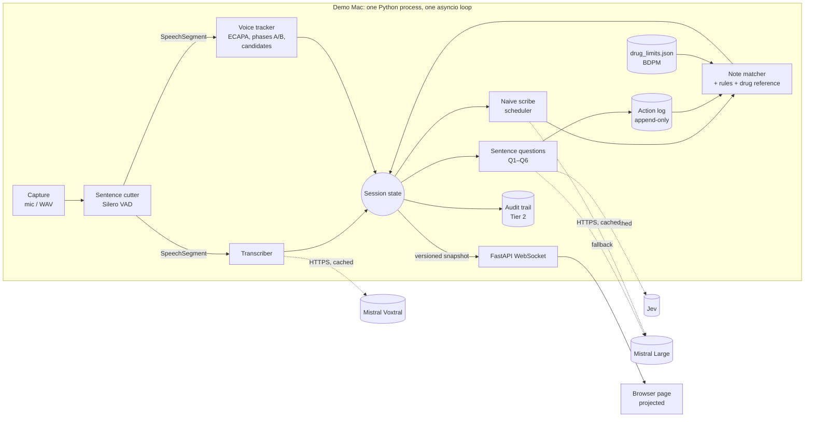
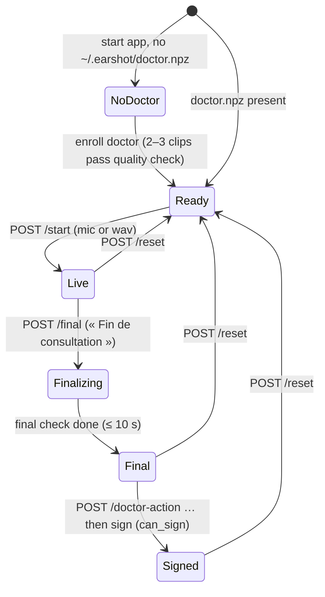
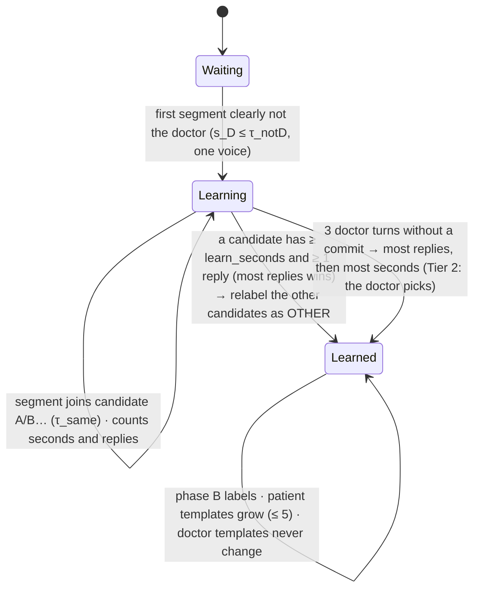

# Earshot: architecture

This document is the technical reference for the build. It complements `spec.md`, which covers what to build and why, and `plan.md`, which covers the order of work. Section numbers like §6.4 point to `spec.md`.

## 1. System overview



- **Everything runs in one process.** No database and no message broker. State lives in memory and the audit trail is written to a JSONL file. This is enough for a 36-hour build and a demo, and it leaves no distributed-systems bugs to chase.
- **Cloud calls are the only network traffic.** Voxtral, Jev and the LLM all go through `Cache.call`, so a rehearsal recording can be replayed without internet (§6.13).

## 2. Components
| Module | Responsibility | In → Out | Tier | Owner |
|---|---|---|---|---|
| `audio/capture.py` | Microphone or WAV file → 32 ms chunks of 512 samples at 16 kHz, mono float32 | device/file → `ndarray` chunks | 1 | Dev A |
| `audio/cutter.py` | Silero `VADIterator` cuts sentences at a 600 ms pause; drops speech under 250 ms; caps sentences at 15 s | chunks → `SpeechSegment` | 1 | A |
| `audio/transcribe.py` | Voxtral (word timestamps), with local Whisper as fallback | segment audio → `Transcript` | 1 | A |
| `audio/voice.py` | Doctor templates (recorded once); phases A/B; candidate voices; commit; relabels | segment → label, scores, relabels | 1 | A |
| `audio/segment.py` | pyannote segmentation-3.0: speaker changes inside a segment, overlaps | segment → sub-segments | 2 | A |
| `audio/media_tag.py` | YAMNet "Television/Radio" score (can only push a label down) | segment → score | 3 | A |
| `brain/normalize.py` | French numbers, units, frequencies, durations, dates → `DoseQuantity` | text → details | 1 | Dev B |
| `brain/drugs.py` | Synonyms, BDPM loader, strengths, action keys, drug-term finder | names → keys | 1 | B |
| `brain/reference.py` | Limits loader (with quote check), prescription and intake checks; live retrieval (Tier 2) | `DoseQuantity` → reason/info/alert | 1 (+2) | B |
| `brain/log.py` | Append-only `ActionLog`; `View` recomputed from current labels; `KeyState` | events → state | 1 | B |
| `brain/rules.py` | `REASONS`, `INFO`, `action_verdict`, `line_verdict` | state → `Verdict` | 1 | B |
| `brain/matcher.py` | Parses the scribe output; verdicts, omissions, ambiguous actions, alerts | note × log → verdicts | 1 | B |
| `brain/questions.py` | Q1–Q6, one batched Jev call per sentence, spotlighting, LLM routing | `Sentence` → events, mentions, claims, intakes | 1 | B |
| `brain/scribe.py` | Naive scribe prompt, neutral transcript, scheduler (latest result wins) | sentences → raw note | 1 | B |
| `brain/second_check.py` | EDS-NLP qualifiers (negation, hypothesis, reported speech) | text → veto flags | 2 | B |
| `infra/cache.py` | `Cache.call` (live / offline) | request → response | 1 | B |
| `infra/clients.py` | `JevClient`, `LLMClient`, `RoutedClient`, `ServiceDown` | — | 1 | B |
| `infra/trail.py` | Hash-chained audit trail | entries → JSONL | 2 | B |
| `pipeline.py` | `Session`: ordering, versions, relabels, snapshots, final check, reset | everything | 1 | A+B |
| `server.py` + `web/` | REST + WebSocket, the projected page | snapshots → screen | 1 | A |

## 3. Runtime model (concurrency)
```mermaid
sequenceDiagram
  participant Cap as capture loop
  participant Cut as cutter
  participant Ses as Session (single loop)
  participant Tr as Voxtral (task)
  participant Vo as voice (thread)
  participant Qs as questions (task)
  participant Sc as scribe (task)
  participant UI as WebSocket
  Cap->>Cut: chunk (32 ms)
  Cut-->>Ses: SpeechSegment (after 600 ms of silence)
  par
    Ses->>Tr: transcribe(segment)
  and
    Ses->>Vo: label(segment) via asyncio.to_thread
  end
  Tr-->>Ses: Transcript
  Vo-->>Ses: label, scores, relabels
  Ses->>Ses: append Sentence (id++), apply relabels
  Ses->>UI: snapshot v+1 (sentence, voice state)
  Ses->>Qs: process_sentence (one Jev call)
  Qs-->>Ses: events / mentions / claims / intakes
  Ses->>Sc: scheduler.on_sentence()
  Sc-->>Ses: raw note (run_id); stale runs dropped
  Ses->>Ses: match → verdicts (note_version++)
  Ses->>UI: snapshot v+2 (verdicts, alerts)
```
- **One event loop.** All state changes happen on it. CPU work (the ECAPA embedding, segmentation) runs through `asyncio.to_thread` so the loop isn't blocked. Network calls are `async` (httpx and the Mistral async client).
- **Ordering:**
  - Each segment gets its sentence id **when it arrives**, before transcription.
  - The transcript and the label are joined under that id, so a slow Voxtral reply can't reorder the conversation.
  - Questions for sentence N run only after sentence N has its label.
- **Versions:**
  - `snapshot.version` goes up on every state change.
  - `note_version` goes up on each scribe result that is accepted.
  - Each verdict records the `note_version` and `log_seq` it was computed from.
  - Stale results are discarded (§6.14).
- **Back-pressure:**
  - At most 1 scribe run in flight. A newer request cancels the older one's *result*; the HTTP call itself is left to finish.
  - At most 4 question calls in flight.
  - Transcription has no limit: segments are short and few.

## 4. State machines

### 4.1 Session

**Reset** clears sentences, the log, the note, verdicts, candidate voices and the patient's voiceprint. **The doctor's voiceprint stays loaded.**

### 4.2 Voice tracker (§6.4)


### 4.3 A verdict
`pending` (waiting for a model answer) → `authorized` / `to_confirm` / `blocked` / `missing`, all with `provisional = true` → after the final check, the same statuses with `provisional = false` → changed only by a doctor action (`confirm`, `remove`, `replace`, `add`, `ignore`), which is logged.

## 5. External interface (`server.py`)
| Method | Path | Body | Effect |
|---|---|---|---|
| GET | `/` | — | the page (`web/index.html`) |
| WS | `/ws` | — | sends the full snapshot on connect and on every change |
| POST | `/enroll/doctor?clips=3&seconds=25` | — | records clips from the mic, checks quality, saves `~/.earshot/doctor.npz` |
| POST | `/start` | `{"source":"mic"}` or `{"source":"wav","path":"fixtures/audio/…"}` | Ready → Live |
| POST | `/stop` | — | stops capture (no final check) |
| POST | `/final` | — | « Fin de consultation » → final check |
| POST | `/doctor-action` | `{"target": key, "action": "confirm"\|"remove"\|"replace"\|"add"\|"ignore"}` | Tier 2 |
| POST | `/pick-patient` | `{"candidate": "A"}` | Tier 2, when the commit is ambiguous |
| POST | `/mode` | `{"mode": "live"\|"offline"}` | switches the cache mode |
| POST | `/reset` | — | new consultation (the doctor's voice is kept) |
| GET | `/clip/{sentence_id}.wav` | — | Tier 2 playback |

**Snapshot (WebSocket message), example after line 4 of the demo:**
```json
{
  "version": 41, "mode": "live", "final": false, "note_version": 3,
  "status": {"voxtral": "ok", "jev": "ok", "llm": "ok"},
  "voice": {"doctor_loaded": true, "patient": "learned", "patient_seconds": 8.6,
            "candidates": [{"id": "A", "seconds": 8.6, "replies": 1, "chosen": true}]},
  "sentences": [{"id": 4, "start": 18.8, "end": 28.7, "speaker": "PATIENT", "final_label": true,
                 "text": "Oui, ma mère travaille en pharmacie…", "scores": {"doctor": 0.18, "patient": 0.89}}],
  "lines": [{"id": "h3", "section": "history", "text": "Ibuprofène pris sur conseil de sa mère"}],
  "actions": [{"key": "prescription:ibuprofene", "type": "prescription", "text": "Ibuprofène 400 mg, 4/jour"}],
  "verdicts": [{"target": "prescription:ibuprofene", "status": "blocked",
                "reasons": ["aucune phrase du médecin", "conseil d'un tiers rapporté par le patient"],
                "info": [], "evidence_ids": [4], "provisional": true}],
  "alerts": [{"kind": "dose_alert", "sentence_id": 4,
              "text": "Prise rapportée : ibuprofène 1600 mg en 24 h — au-dessus du maximum (RCP : 1200 mg/jour)"}]
}
```
**The page is a pure function of the latest snapshot.** It keeps no state of its own, apart from the ON/OFF switch and the currently selected line.

## 6. Configuration
- `config/thresholds.json`: the template is at the end of `test-results.md`. Every number comes from Phase 0.
- `config/models.json`:
```json
{
  "embedder": "speechbrain/spkrec-ecapa-voxceleb",
  "transcriber": {"provider": "mistral", "model": "voxtral-mini-latest", "word_timestamps": true, "context_bias": "reference/drug_hints.txt"},
  "transcriber_fallback": {"provider": "whisper", "model": "large-v3-turbo"},
  "questions": {"primary": {"provider": "jev", "model": "jev-latest"}, "fallback": {"provider": "mistral", "model": "mistral-large-latest"}},
  "scribe": {"provider": "mistral", "model": "mistral-large-latest", "temperature": 0},
  "prompt_version": "v1",
  "timeouts_s": {"voxtral": 8, "jev": 8, "llm": 15}
}
```
- `.env` (git-ignored): `MISTRAL_API_KEY`, `JEV_API_KEY`, `HF_TOKEN` (Tiers 2–3), and AWS credentials if Bedrock is used.
- `reference/`:
  - `drug_limits.json` (S8)
  - `bdpm/*.txt`, ISO-8859-1 encoded
  - `rcp/*_4.2.txt`
  - `drug_hints.txt`: ≤ 100 drug names for Voxtral's `context_bias`, never generated from the note

## 7. Time budget per sentence (the target is ≤ 2 s from end of speech to label; S2 measures it)
| Step | Budget | Note |
|---|---|---|
| End-of-sentence detection | 0.60 s | the 600 ms silence rule (fixed) |
| ECAPA embedding (CPU, ≤ 15 s of audio) | ~0.1 s | runs in parallel with the transcription |
| Voxtral round trip | ≤ 1.0 s | to measure in S2/S3; the Whisper fallback runs locally on MPS |
| Snapshot to the screen | < 0.05 s | local WebSocket |
| **Label and text on screen** | **≤ 2 s** | |
| Jev, one batched call | 0.07–0.5 s | from the Jev launch notes; to measure in S4 |
| Scribe (LLM, full note) | 2–6 s | the bottleneck; the reveal comes after the dialogue, so this is acceptable |
| Spoken confirmation shows as ✅ | ≤ 5 s | the scribe run after line 8 plus the matcher |
| Final check | ≤ 10 s | one scribe run plus recomputation |

## 8. What still works when something breaks (§6.13, C8)
| Failure | Effect | What to do |
|---|---|---|
| Voxtral down or slow | that status light turns red; sentences are labelled but have no text yet | switch the transcriber to Whisper (config) or switch to offline replay |
| Jev down | routed to the LLM (`RoutedClient`); slower | nothing; the light shows it |
| LLM down | no scribe note; verdicts stay `pending` | offline replay |
| No network | everything external fails | `POST /mode {"mode":"offline"}` + replay `demo_rehearsal.wav` |
| Microphone problem | no segments | replay the WAV (`/start {"source":"wav"}`) |
| Everything | — | the backup video |

## 9. Data and privacy boundaries
| Data | Where it lives | Leaves the Mac? |
|---|---|---|
| Doctor's voiceprint | `~/.earshot/doctor.npz` (with consent) | no |
| Patient's voiceprint, candidate voices | memory; cleared on reset | no |
| Audio | memory (playback); recordings in `fixtures/audio/` (git-ignored) | **yes**: each sentence's audio goes to Voxtral |
| Transcript | memory, audit trail, cache | **yes**: to Jev and the LLM |
| Drug data | `reference/` (public) | no |

Production would need certified health-data hosting (HDS), zero data retention at the providers, and on-device voiceprint storage (§10).

## 10. Repository layout (built at the event)
See `plan.md` → "File structure". Tests mirror `src/`. Test data lives in `fixtures/`: the audio isn't in git, the JSON sets are.
